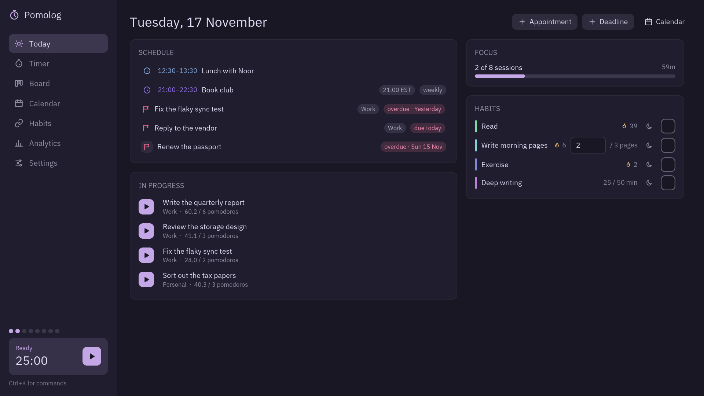
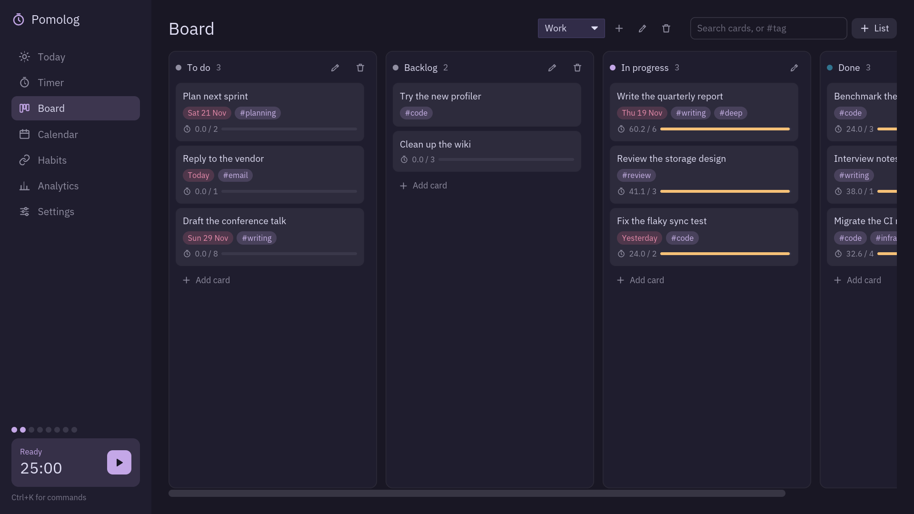
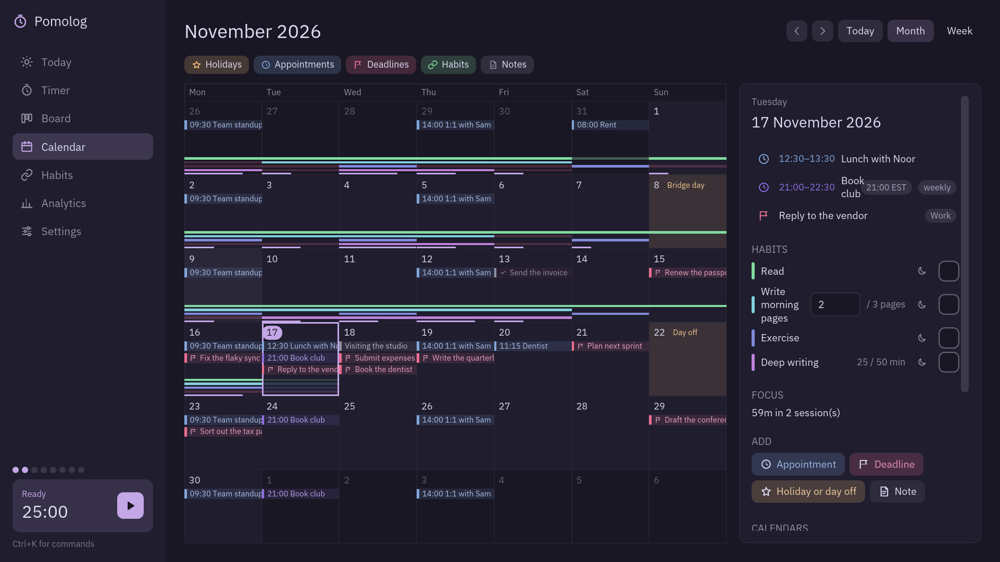
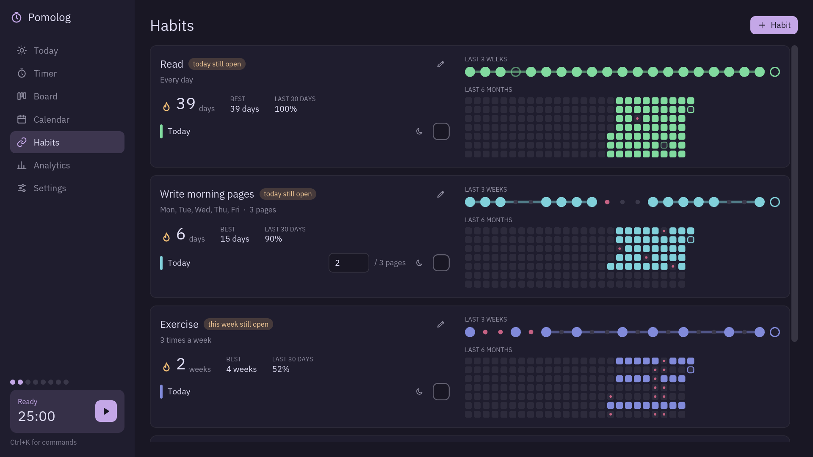
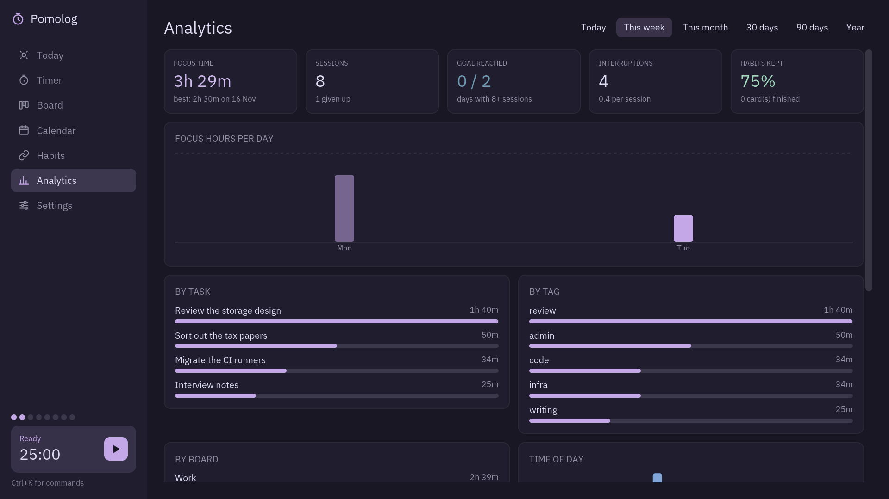
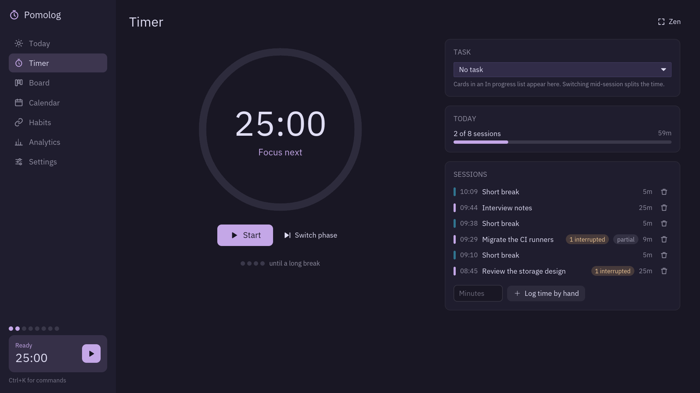

# Pomolog

> [!WARNING]
> **This project was vibecoded.** It was written mostly by an AI coding
> assistant (Claude Code), with direction and review from a human. Expect
> rough edges, and read the code before trusting it with data you care about.

> [!NOTE]
> Inspired by [PomodoroLogger](https://github.com/zxch3n/PomodoroLogger) by
> zxch3n, an Electron pomodoro, kanban and time-tracking app that has since
> been archived and is no longer maintained. Pomolog is a from-scratch take on
> the same idea, not a fork.

A pomodoro timer that also keeps your tasks, calendar and habits, and shows
you where the time went. A native Linux app written in Rust.

- **Timer**: focus, short and long breaks; pause, skip, abandon, extend; an
  optional flow mode that counts up and sizes the break to the time worked.
  Interruptions are logged, with a reason if you give one.
  Short chimes mark the end of a focus session or a break, and optionally an
  auto-started phase or the last minute.
- **Board**: kanban boards with custom lists. Cards have estimates, due
  dates, tags and notes. Time is logged against the card you are working on.
- **Calendar**: month and week views that keep five things apart:
  holidays (tinted days), appointments (timed), deadlines (flagged, can be
  ticked off), notes (a title and some text on a day) and habits (lines that
  join up across days). Items live in calendars that you create, colour and
  show or hide, and a time can be written in another time zone.
- **Habits**: don't-break-the-chain tracking. Yes/no, quantity, or
  focus-linked habits that tick themselves off from logged focus time.
  Rest days, holidays and a few skips a month keep one bad day from ending
  a long chain.
- **Analytics**: focus per day, by task, tag and board, time of day,
  estimate accuracy, interruption reasons, a year heatmap.
- **Themes**: follows your GTK or Qt colours by default and updates when
  they change. Dark unless the desktop says otherwise.

Everything is stored locally in one SQLite file.

## Screenshots



| | |
|---|---|
|  |  |
|  |  |



Screenshots use the sample data from `cargo run --example seed`.

## Install

Pomolog runs on Linux (x86_64 and aarch64), on Wayland or X11. It uses a
StatusNotifier tray, D-Bus notifications and ALSA/PipeWire for sound.

### Nix

Try it without installing:

```sh
nix run github:nebunebu/pomolog
```

Install into your profile:

```sh
nix profile install github:nebunebu/pomolog
```

With Home Manager:

```nix
{
  inputs.pomolog.url = "github:nebunebu/pomolog";

  # in your home-manager configuration
  imports = [ inputs.pomolog.homeManagerModules.default ];
  programs.pomolog = {
    enable = true;
    autostart = true;   # tray icon and CLI available from login
    # settings = { timer.focus_min = 50; };   # optional, writes config.toml
    # themes.mine = { inherit = "system"; colors.focus = "#ff8800"; };
  };
}
```

If `settings` is set, `config.toml` is managed by Home Manager and is
read-only, so changes made in the app's Settings are not saved. Leave it
unset to manage settings from the app.

On NixOS or elsewhere, add `inputs.pomolog.packages.${system}.default` to
your packages, or apply `inputs.pomolog.overlays.default` and install
`pkgs.pomolog`.

### From source

You need Rust 1.85 or newer (edition 2024), `pkg-config`, and the
development files for D-Bus, ALSA, Wayland, xkbcommon, Vulkan and OpenGL.
SQLite is bundled.

```sh
# Debian / Ubuntu
sudo apt install build-essential pkg-config libdbus-1-dev libasound2-dev \
  libwayland-dev libxkbcommon-dev libvulkan-dev libgl1-mesa-dev

# Arch
sudo pacman -S --needed base-devel pkgconf dbus alsa-lib wayland \
  libxkbcommon vulkan-icd-loader mesa

# Fedora
sudo dnf install gcc pkgconf-pkg-config dbus-devel alsa-lib-devel \
  wayland-devel libxkbcommon-devel vulkan-loader-devel mesa-libGL-devel
```

Then build and install the binary into `~/.cargo/bin`:

```sh
git clone https://github.com/nebunebu/pomolog
cd pomolog
cargo install --path .
```

For a launcher entry and icon:

```sh
install -Dm644 assets/pomolog.desktop ~/.local/share/applications/pomolog.desktop
install -Dm644 assets/icon.svg ~/.local/share/icons/hicolor/scalable/apps/pomolog.svg
```

To start it with your session, have your compositor or desktop run `pomolog`
at login (for example `exec-once = pomolog` in Hyprland).

## Command line

Without arguments `pomolog` opens the window, or raises it if it is already
running. Closing the window leaves the timer running in the tray.

```sh
pomolog toggle            # start, pause or resume
pomolog skip              # on to the next phase
pomolog abandon           # give up on this focus session
pomolog show calendar     # open the window on a view
pomolog status            # focus 12:34 (running) · Write the report
pomolog status --json     # for bars and scripts
pomolog add "Write the report" --due fri --board work --tag writing
pomolog in "Dentist fri 2pm for 45m"
pomolog quit
```

The timer and window commands talk to the running app. Everything that adds
or changes data (`add`, `in`, `event`, `note`, `calendar`) writes to the
database itself, so it works whether or not the app is running, and a running
app shows the change within a second.

### One line in

`pomolog in` (and the same box behind Ctrl+K in the app) takes a line of text
and works out what it is:

| You type | You get |
|---|---|
| `Dentist fri 2pm for 45m` | an appointment (a time makes it one; today if no date) |
| `Tax return Apr 15` | a deadline (a date and no time) |
| `Report due fri @work #writing` | a card with a due date, on the board `work`, tagged |
| `note: gate code 4411` | a note on today (or on the date in it) |
| `Buy milk` | a card |

`@name` picks the board of a card or the calendar of an item.

### Calendar items

```sh
pomolog event "Book club" --date "Jan 5" --time "9:00 PM Eastern" --duration 90
pomolog event "Standup" --date mon --time 9:30 --repeat weekly --calendar Work
pomolog event "Day off" --date 12/24 --kind holiday
pomolog note "Visiting the studio" --date fri --body "Ask for Sam"

pomolog event list                         # today and the next 30 days, with ids
pomolog event list --from "Jan 1" --to "Jan 31" --calendar Work --json
pomolog event edit 12 --time 8pm --duration 60   # only what you give changes
pomolog event edit 12 --tz none                  # "none" clears a field
pomolog event rm 12

pomolog calendar list
pomolog calendar add Work --color "#4a8fe7" --tz Eastern
pomolog calendar rm Work --force           # its items go with it
```

Adding the same item twice does nothing the second time (`--allow-duplicate`
overrides that). With `--source some-id` an item gets an id of your own, and
adding it again updates it, which is what a script that runs more than once
wants.

Many at once, from a file or standard input (`-`):

```sh
pomolog event import holidays.ics --kind holiday
pomolog event import club.jsonl --time "9:00 PM Eastern" --duration 90
```

An import is an `.ics` calendar, or one JSON object per line with the same
names as the options: `{"title": "Book club", "date": "Jan 5"}`. Options on
the command line fill in what an entry leaves out. Importing a file again adds
nothing.

### Dates, times and zones

Dates accept `2026-12-01`, `today`, `tomorrow`, a weekday name (the next one),
`+3d`, `+2w`, and a month and day with or without a year: `Jan 5`, `5 Jan`,
`1/5` (month/day), `Jan 5 2027`. Without a year it is the next such day.

Times accept `21:00`, `2100`, `9pm` and `9:30 PM`. They are local unless a
zone follows the time or is given with `--tz`: an IANA name
(`America/New_York`) or `Eastern`, `Central`, `Mountain`, `Pacific`, `UTC`.
The app shows such an item at your local time, with the original beside it. A
calendar can have a zone of its own, which new items in it take.

### Keyboard

In the app: Space starts and pauses, Ctrl+K opens the command palette,
Ctrl+1 to Ctrl+7 switch views, Esc closes dialogs and zen mode.

Global shortcuts come from your compositor. Hyprland, for example:

```
bind = SUPER, P, exec, pomolog toggle
bind = SUPER SHIFT, P, exec, pomolog show timer
```

### Vim-style keys

Outside text fields, single letters move around. `?` lists them all.

| Where | Keys |
|---|---|
| Anywhere | `g` then `d` `t` `b` `c` `h` `a` `s` for Today, Timer, Board, Calendar, Habits, Analytics, Settings; `:` palette; `/` search the board |
| Calendar | `h` `l` day, `j` `k` week, `H` `L` month, `t` today, `m` `w` month or week view, `a` `d` `n` new appointment, deadline, note, Enter opens the day's first item |
| Board | `h` `l` list, `j` `k` card, `H` `L` move the card across, `J` `K` move it down or up, `o` add a card, Enter open, `s` start focusing on it |
| Habits | `j` `k` habit, `x` tick it for today, Enter edit |
| Timer | `s` skip |

Switch them off in Settings, or with `[keys] vim = false`.

### Sounds

Settings → Sounds switches each cue on or off and sets the volume. The
built-in chimes are generated by the app. To use your own files (wav, ogg,
flac or mp3, cut off after 10 seconds), set them in `config.toml`:

```toml
[sounds]
enabled = true
volume = 0.6
focus_end = true        # a focus session runs out
break_end = true        # a break runs out
auto_start = true       # a phase starts by itself (auto-start)
minute_warning = false  # one minute left (phases longer than 90 s)
focus_end_file = "~/sounds/bell.ogg"   # empty = built-in chime
break_end_file = ""
auto_start_file = ""
minute_warning_file = ""
```

If no audio device can be opened, sounds are skipped silently.

## Themes

The default theme, `system`, reads:

1. dark or light from the desktop portal (dark when it has no preference);
2. colours from `~/.config/gtk-4.0/gtk.css` (then `gtk-3.0`), following
   `@import` and `@define-color`, the same names libadwaita uses;
3. or, with `source = "qt"`, from the qt6ct/qt5ct colour scheme or
   `kdeglobals`.

These files are watched, so tools that rewrite them (matugen, for example)
restyle Pomolog as they go.

On top of that you can override any colour, in Settings or in
`~/.config/pomolog/config.toml`:

```toml
[appearance]
theme = "system"      # or a preset: rose-pine, gruvbox, nord, paper
mode = "system"       # system | dark | light
source = "auto"       # auto | gtk | qt
radius = 10
scale = 1.0
clock = "24h"         # or "12h" for 9:00 PM

[overrides]
accent = "#ff8800"    # focus follows the accent unless set itself
habit = "#7fd49e"
```

### Theme files

A theme is a TOML file in `~/.config/pomolog/themes/`. It can stand alone:

```toml
name = "Mine"
mode = "dark"

[colors]
bg = "#101418"
text = "#e6e6e6"
accent = "#5fd7a7"
```

Only `bg`, `text` and `accent` are needed; the rest is derived. Or it can
adjust the system theme:

```toml
inherit = "system"

[colors]
focus = "#ff8800"
deadline = "#ff5577"
```

Colour names: `bg`, `surface`, `surface2`, `surface3`, `text`, `text_dim`,
`accent`, `on_accent`, `focus`, `short_break`, `long_break`, `holiday`,
`appointment`, `deadline`, `habit`, `success`, `warning`, `danger`,
`outline`. "Save this look as a theme file" in Settings writes the current
palette out in full as a starting point.

## Data

| What | Where |
|---|---|
| Database | `~/.local/share/pomolog/pomolog.db` |
| Settings | `~/.config/pomolog/config.toml` |
| Themes | `~/.config/pomolog/themes/*.toml` |

Settings has export and import of everything as one JSON file, and a
delete-all button. Holiday calendars and other `.ics` files can be imported
from the calendar's day panel.

## Development

```sh
nix develop
cargo test
cargo run

# a throwaway database with two months of sample data
POMOLOG_DATA_DIR=/tmp/pomolog-demo cargo run --example seed
POMOLOG_DATA_DIR=/tmp/pomolog-demo cargo run
```

`POMOLOG_DATA_DIR`, `POMOLOG_CONFIG_DIR` and `POMOLOG_SOCKET` relocate the
app's own files; `POMOLOG_SYSTEM_CONFIG_HOME` points it at a different GTK/Qt
configuration, which is handy for trying a theme.

The logic (timer, habits, recurrence, statistics, theme parsing) lives in
`src/core` and `src/theme` and has no GUI dependency. `src/ui` is the
[iced](https://iced.rs) interface.

## Not there yet

- App usage logging and the distraction score from the original.
- Calendar sync (CalDAV, `.ics` subscriptions by URL) and `.ics` export.
- Time zones named in an imported `.ics` file: those times are read as local.
- Do-not-disturb during focus, idle detection.
- Native file pickers: import and export take a typed path.

## Licence

MIT. See [LICENSE](LICENSE).
